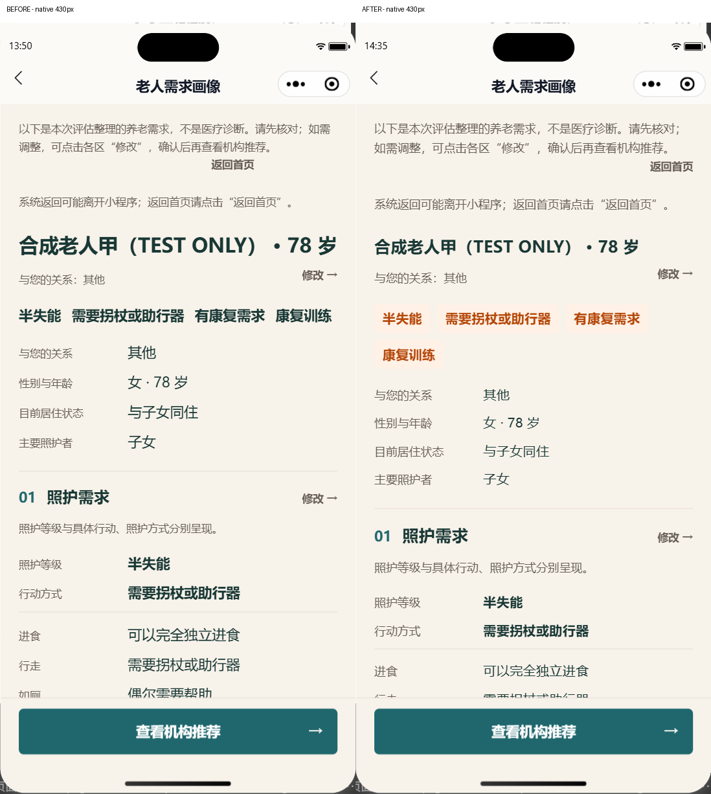
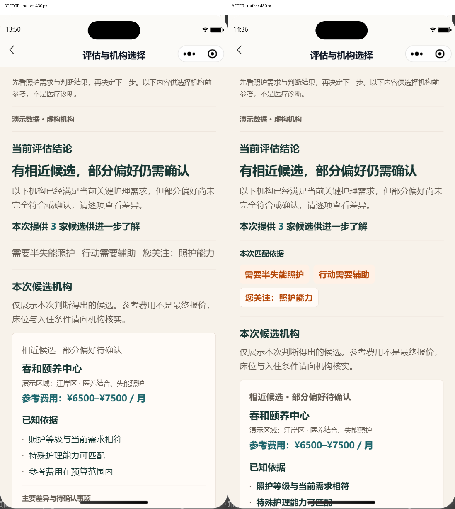

# GLOBAL_UI_UX_PROFILE_RECOMMENDATION_HIERARCHY_V1

```ini
STATUS = READY_FOR_OWNER_VISUAL_REVIEW
DOC_IMPACT = AUDIT_ONLY
ANDROID_RETEST = NOT_RUN
GIT_COMMIT = NOT_RUN
GIT_PUSH = NOT_RUN
WECHAT_UPLOAD = NOT_RUN
REVIEW_SUBMISSION = NOT_RUN
PRODUCTION_RELEASE = NOT_RUN
```

2026-10-25，北京时间。工作区为 `wuhan-eldercare-v2-1-b1-2-4`，基于本地冻结提交 `7ae07b9b78e4502940fd9812c6a838e4ddf2cc06` 及现有未提交 Batch A 成果。此报告仅交付画像、推荐结果两页的局部展示优化，等待 Owner 视觉审核。

## 展示改动

- 画像页直接循环既有 `overviewTags`，使用独立可换行标签、浅橙 `#FFF1E6` 和深橙 `#B54708`；未筛选、推导、改写或排序。照护等级、行动方式、已报告健康情况与近期健康风险适度加粗，其余字段与说明维持次级层级。
- 推荐页直接循环既有 `focusTags`，增加“本次匹配依据”分组标题。照护与行动需求使用浅橙标签，家庭关注使用描边标签；不拆解文字、不新增依据。匹配结论与 positive 已知依据适度加粗，差异和待核验事项继续显示完整文字。
- 两页复用 `readBrowseFontStyle` 读取字体设置，只写入页面展示样式。150% 检查发现微信默认按钮宽度挤窄画像分区标题，因此仅在该页将“修改”按钮宽度设为自适应；机构名称随既有字号变量放大。推荐依据及咨询清单采用均衡换行，避免单字尾行。
- 暖白背景、深青标题、亮橙品牌色、圆角 Token、主 CTA 样式及事件均保留。未改全局 Token、ViewModel、领域服务或业务契约。Demo 虚构机构与演示数据说明保留。

## 修改范围与既有成果保护

现有源文件仅修改以下 6 个文件：

- `miniprogram/pages/assessment/profile.ts`
- `miniprogram/pages/assessment/profile.wxml`
- `miniprogram/pages/assessment/profile.less`
- `miniprogram/pages/recommendation/result.ts`
- `miniprogram/pages/recommendation/result.wxml`
- `miniprogram/pages/recommendation/result.less`

新增 `scripts/check-profile-recommendation-hierarchy.mjs`、本报告及本任务证据目录。对任务开始时记录的 580 个源文件进行字节哈希复核，仅上述 6 个文件变化；其他 574 个文件（包括 Batch A 源文件、全局 Token）保持一致。见 [源文件保护结果](global-ui-ux-profile-recommendation-hierarchy-v1-evidence/source-preservation.json)。未暂存或提交，既有 dirty 文件仍保留。

## 数据与业务边界

[展示模型基线](global-ui-ux-profile-recommendation-hierarchy-v1-evidence/display-baseline.json) 在修改前记录；[最终对比](global-ui-ux-profile-recommendation-hierarchy-v1-evidence/data-comparison.json) 为 PASS：

- 完整 Profile / Recommendation ViewModel 的修改前后哈希相同，包含业务值、原因、差异、身份、revision 及展示顺序。
- 画像标签仍为：半失能 → 需要拐杖或助行器 → 有康复需求 → 康复训练。
- 推荐依据仍为：需要半失能照护 → 行动需要辅助 → 您关注：照护能力。
- 候选顺序仍为 `demo-inst-chunhe-center` → `demo-inst-chunhe-home` → `demo-inst-kangyi-center`，revision 均为 1。
- 同一测试会话中，读取展示模型前后完整演示保存状态的摘要一致，包括已保存快照和实体 ID；外部副作用为零。
- 开发者工具运行时的两页完整 `viewModel` 与修改前读取值分别作序列化比较，均相同。见 [原生证据](global-ui-ux-profile-recommendation-hierarchy-v1-evidence/final-native-evidence.json)。

独立初始化的测试 VM 会生成新的 localDraftId。测试修正为“跨会话比较完整展示模型；同会话比较完整保存状态”，没有归一化、改写或重新生成实际历史快照，也不将独立 VM 的随机 ID 宣称为相同。原始基线未重录。

## 原生截图与尺寸验收

使用微信开发者工具实际 WXML/WXSS 渲染，非 HTML 复刻。实际设置机型宽度为 320、375、430px；150% 使用 320px 且 `fontSizeSetting=24`（标准为 16）。基础库 3.17.3，平台字段为 `devtools`。截图 PNG 像素尺寸受工具缩放影响，不将图片宽度冒充逻辑视口。

| 实际视口 / 字号 | 画像内容宽 × 高 px | 推荐内容宽 × 高 px | 画像标签区域高 | 匹配依据区域高 |
| --- | ---: | ---: | ---: | ---: |
| 320 / 16 | 286 × 3237.00 | 286 × 2981.60 | 78.40 | 123.49 |
| 375 / 16 | 335.33 × 2665.28 | 335.33 × 3148.45 | 78.40 | 125.49 |
| 430 / 16 | 386 × 2613.35 | 386 × 3186.75 | 78.40 | 126.49 |
| 320 / 24 | 286 × 4745.03 | 286 × 4742.24 | 156.38 | 213.02 |

最终重点截图共 40 帧，另保留修改前截图、早期逐屏检查和补拍。标签可换行，无裁切或横向越界；长行动标签在 320 / 24 下宽 212px、可用宽 286px。该尺寸下画像照护标题从被默认按钮挤压的 96px 恢复为约 204.74px，“修改”按钮宽约 75.26px，标题可完整阅读。已知依据及待核验说明的均衡换行保留全部文字。

画像固定底栏在 320px 下 top=507.33、height=60.67，二者相加约为 screenHeight=568；375px 下为 705.33+106.67≈812，430px 下为 816.33+115.67≈932。offset 使用完整模拟屏幕坐标，不能直接与 windowHeight 比较。末尾说明可滚动到 CTA 上方，推荐页末尾按钮和安全区可见。页面中途内容经过固定底栏下方是滚动过程，最终一行没有永久遮挡。

几何数据保存在 `final-native-evidence.json`。普通 view 不支持工具的 scrollWidth 接口，返回的错误原样保留，未将其标记为测量通过；横向检查依据实际视口、容器及标签尺寸和逐屏截图。

### 修改前后

以下为同一 Demo 案例、430px 标准字号实际截图拼接，仅添加 Before / After 标题，未修改页面图像内容。





### 复核入口

- [320px 最终重点截图](global-ui-ux-profile-recommendation-hierarchy-v1-evidence/final-review-320.jpg)
- [375px 最终重点截图](global-ui-ux-profile-recommendation-hierarchy-v1-evidence/final-review-375.jpg)
- [430px 最终重点截图](global-ui-ux-profile-recommendation-hierarchy-v1-evidence/final-review-430.jpg)
- [320px / 150% 最终重点截图](global-ui-ux-profile-recommendation-hierarchy-v1-evidence/final-review-320-font150.jpg)
- [150% 清单末尾最终补拍](global-ui-ux-profile-recommendation-hierarchy-v1-evidence/final-320-font150-recommendation-6.png)
- [截图逐项索引](global-ui-ux-profile-recommendation-hierarchy-v1-evidence/README.md)

最后一次清单均衡换行补拍了 320px、375px、430px 和 320px / 150% 的推荐页末尾，其内容高度均未变化。初次切换机型/字体后因模拟器异步回首页而失效的采集未计入验收；在实际路由、有效案例和字体设置确认后重拍。

## 实际交互

在 320px / 150% 下进行可见界面点击及自动化元素 tap，没有直接调用页面事件处理函数：

| 操作 | 实际结果 |
| --- | --- |
| 原生可见界面点击“调整老人需求” | 到达画像页 |
| 原生可见界面点击画像固定 CTA | 到达推荐结果页 |
| tap“修改基本情况”并返回 | 到达 basic，返回画像，未更改答案 |
| tap 春和颐养中心“更多依据” | expandedCards 对应键变为 true，补充资料可见；再次 tap 变为 false |
| tap 同机构“查看机构详情” | institutionId=demo-inst-chunhe-home、recordRevision=1、source=recommendation，保留 sourceContextRef |
| 从机构详情返回 | 回到原推荐页 |

路由及展开状态原始结果见 `final-native-evidence.json`；截图见 `interaction-expanded.png` 和 `interaction-institution-detail.png`。失败导航、重复点击和生命周期行为由既有 profile/result 交互专项回归覆盖，未把这些自动化分支称为 Android 触摸证据。测试结束恢复 Demo 430px / 16px，停在画像页。

## 构建与相关回归

Demo / Production 双构建成功：TypeScript 4.1.2、Less、原生 WXML、生成 JS 语法检查通过。未调整阈值。

| 构建 | 本地 runtime bytes | 既有预算 bytes | 余量 bytes |
| --- | ---: | ---: | ---: |
| Demo | 1,946,110 | 2,031,616 | 85,506 |
| Production | 1,343,880 | 2,031,616 | 687,736 |

以上仅为本地运行文件，微信最终上传包体积 `NOT_RUN`，本轮没有打包上传。对任务开始的 Batch A 基线，两种构建均增加 2,715 bytes。

以下 9 项相关检查全部通过；[完整日志](global-ui-ux-profile-recommendation-hierarchy-v1-evidence/final-checks.json)：

1. `check-profile-recommendation-hierarchy.mjs`
2. `check-profile-v2-ui-runtime.mjs`
3. `check-recommendation-result-v2-ui-runtime.mjs`
4. `check-profile-result-v2-interactions.mjs`
5. `check-run-mode-convergence.mjs`
6. `check-wechat-js-compat.mjs --demo --artifact-dir dist/demo/miniprogram`
7. `check-wechat-js-compat.mjs --artifact-dir dist/production/miniprogram`
8. `check-run-mode-package-size.mjs`
9. `check-global-ui-ux-batch-a.mjs`

最终追加清单换行样式后，重新通过双构建、完整展示模型/保存状态对比和包体积检查；其他 JS/交互检查在相同 TS/WXML 上通过。Demo/Production provider 隔离检查通过，未新增真实通信、网络、导航权限或存储写入路径。Assessment V2、ElderProfile V2、Recommendation V2、Institution verification、保存快照与排名实现均未改。

## 剩余风险与下一步

- Android 真机及 Codex ADB 检查本轮均为 `NOT_RUN`；B1.2.6 既往 Owner 人工通过不能代替本次局部样式复测。
- `text-wrap: balance` 已在当前开发者工具渲染验证；较旧 WebView 对该 CSS 的支持仍需 Owner 真机观察，不支持时回退自然换行，完整文本仍保留。
- 未扩大到其他页面，Batch A 原有跨页缺口仍由原报告跟踪。
- Owner 需要确认两页橙色标签、信息层级及大字号视觉效果。此状态不是功能重新冻结，也不授权提交、上传、提审或发布。

完成本轮实现与报告后停止，等待 Owner 审核。
