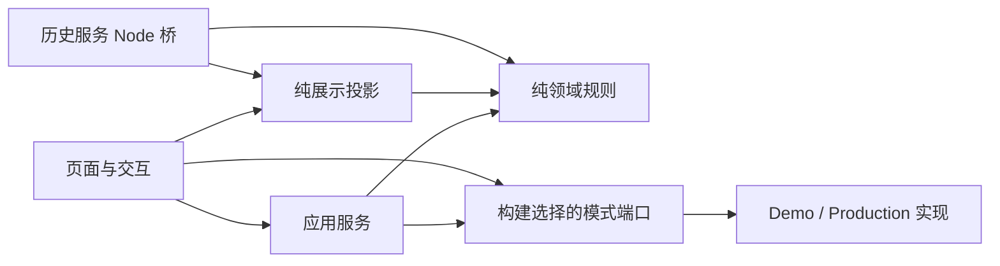

# 架构基础升级：模式、共享核心、自动回归

2026-10-28；范围为用户选择的架构第 1、2、3 项，基线 `bc97ff05ff04f5e7464a41ebbabd7ee732936e9f`。

## 做成了什么

1. **模式行为可直接阅读与检查。** 构建按文件选择启动、目录 Provider、文案、机构展示和导航适配器，移除两份向 TypeScript 插入逻辑的字符串组合脚本。共享页面逻辑仍在 miniprogram，完整模式视图与配置在 modes；正式与 Demo 的网络、存储和数据边界保留。
2. **前后端共用纯模块。** 机构校验/投影、推荐显示语义归入 domain；共享画像/推荐 ViewModel 归入 presentation。Domain 不再反向导入 pages/services/runtime，旧路径兼容导出。服务端 Maven 直接打包纯模块，C2 历史快照与排序未改变。
3. **自动回归覆盖当前架构。** 新 AST 依赖检查覆盖类型和运行导入，模式来源检查拒绝注入与跨模式选择。工作分支推送触发源码 CI，新增 C1 三项、P1 和架构检查；纠正详情字号刷新、VR 状态页的旧静态误判，继续验证实际资源门禁。

## 验证与边界

- 最终源码 CI 集合 14 项、本机相关运行检查 9 项全部通过，含 V2/C1/P1、评估交互、目录/详情、Demo 故事、评价及原性能回归。[逐项结果](../../../output/architecture-foundation-20261028/final-checks/results.json)
- 105 个纯模块/关联类型、465 条依赖边通过；4 正/12 负依赖夹具和 2 正/3 负模式选择夹具通过。新增模式运行检查覆盖真实换行文案、展示别名不修改输入、身份/版本/来源导航与正式资源关闭。
- Demo/Production 的 TypeScript 4.1.2、Less、原生 WXML 构建通过，均 31 条路由。原始运行目录分别约 1952/1360 KiB，均在现有 1984 KiB 本地预算内；这不是微信上传包测量。
- 生成 JS 的 224/236 个模块通过完整兼容扫描与正负自测。检查清单按构建标记验证实际 runtime/纯模块，直接源码检查仍要求原 Mock；未放宽 class fields、可选链或空值合并的检查。
- C2 三种状态（旧 V2、初步参考、无个性候选）完整 JSON 与原基线相等。Maven 离线资源目标实际选出独立资源，打包后的三个 C2 向量及两条历史 Node 桥实际执行通过；历史闭包 40 模块/184 边均解析。[资源验证](../../../output/architecture-foundation-20261028/server-resource/results.json)
- 开发者工具实际走通 Demo 首页→春和详情→模拟顾问→返回、画像/推荐及关联地图/VR；正式首页 11 家、正式详情无 Demo 控件且预约关闭。两模式控制台按 error 查询无匹配。六张截图、工具中断恢复过程与范围见 [GUI 记录](../../../output/architecture-foundation-20261028/gui/SUMMARY.md)；已恢复 430px/字号20。
- 本轮未改 Java 业务逻辑，未执行 Java 编译/全套后端测试；未上传、提审、发布或开启真实业务，未将本轮验证表述为手机验收。

## 后续怎么改

新增模式差异优先实现对应 runtime 端口；静态视图在模式 pages/overrides 修改，不恢复源码关键词替换。纯逻辑新增到 domain，前后端共用显示投影新增到 presentation。开发时运行 `npm run check:architecture-boundaries`；改模式后执行双构建及 `npm run check:mode-adapters-runtime`、模式隔离和相关页面检查。

结构规则与入口见 [前端结构](../../architecture/FRONTEND_STRUCTURE.md)。本次完成三项架构基础，不提前实施分包、改写后端运行机制或接通正式历史页面。
